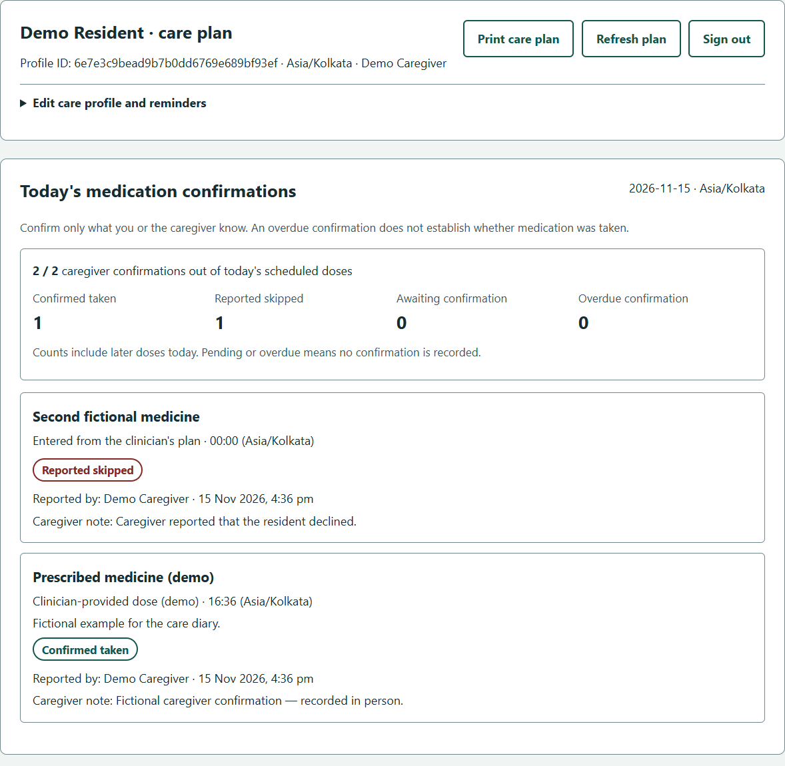
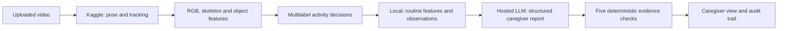

# BehaviorSense AI

**Shared care profiles, medication confirmations, appointments and evidence-backed activity reports.**

[PromptWars x Catalyst](https://hack2skill.com/event/promptwars-x-catalyst) · **Chosen vertical: Elderly Care & Assisted Living** · [Run the demo](#run-the-project) · [Backend notebook](notebooks/notebookef04f4f9bb%20%281%29.ipynb) · [Research results](results/rgb_improvement_20261015.md)

BehaviorSense helps family members and caregivers manage an elderly person's daily care in one shared profile. It stores prescribed medication schedules, caregiver-reported intake, doctor appointments and email reminders. Its optional video workflow adds activity timelines and caregiver reports whose structured claims can be checked against recorded evidence.

The project is an existing research prototype adapted for this competition. This repository contains a fresh source snapshot for the competition, with one `main` branch. Earlier development history remains available in the [original repository](https://github.com/PARTHG0106/BehaviorSense), and the research reports are included here.

This public submission repository stays below **10 MB** and uses one `main` branch. It includes the full application code, tests and Kaggle notebook. See the [submission package details](docs/14_competition_submission.md). Model weights are supplied by the public Kaggle datasets listed below.

## Try the care demo in two minutes

From a cloned repository with Python 3.11 or later:

```powershell
python -m pip install -r requirements-serve.txt
python web/care_backend.py
```

Open **http://127.0.0.1:8787** and choose **Try a fictional care profile**. The homepage opens the care platform, with a dose due now and a doctor appointment. The expandable walkthrough guides you through confirmations, notes, medication edits, appointments, reminder previews, accessibility controls and printing. Kaggle and an LLM key are optional for the separate video workflow.

Today's summary counts **taken, skipped, pending and overdue confirmations** from the recorded schedule. Future doses remain pending; a missing confirmation is not counted as a missed medication. An optional caregiver note is saved with each confirmation and remains in the history. Use **Print care plan** for a readable medication, appointment and confirmation record.

## Competition fit and current scope

The published challenge is **Elderly Care & Medication Management Platform**. BehaviorSense implements its care-management workflow and adds an optional observation and reporting layer.

| Challenge requirement | Current implementation |
|---|---|
| Keep family members and caregivers informed | Shared care notes, medication schedule, confirmation history, appointments and optional activity reports |
| Make care accessible and reliable | English, Hindi and Marathi care views; keyboard navigation; large text; high contrast; reduced motion; labelled forms and visible errors |
| Monitor medication adherence | Explicit caregiver-reported taken/skipped records, pending and overdue confirmations, timestamps and caregiver names |
| Shared healthcare profile and passcode access | Random profile IDs, generated access codes, salted PBKDF2 hashes, expiring sessions and profile-scoped API access |
| Add/edit medication schedules and doctor appointments | Daily dose times, prescribed instructions, start dates, active/stopped medications, editable appointments and attended/cancelled status |
| Email reminders for upcoming or missed doses and appointments | Background scheduler, deduplicated email outbox, previews by default and SMTP delivery when explicitly configured |

Intake records are caregiver reports. Video predictions do not create medication confirmations. An overdue confirmation means the care team needs to check the plan; it does not prove that a person missed a dose.



## What you can demonstrate

- Create a private care profile and share its ID and access code with a trusted caregiver.
- Add or edit prescribed medications and daily dose times; confirm taken or skipped doses and inspect their history.
- Inspect today's confirmation counts, record a caregiver note and print the care plan for a visit.
- Keep doctor appointments, update attendance and inspect due reminder previews.
- Choose English, Hindi or Marathi; increase text size, enable high contrast or reduce motion.
- Upload a video and inspect tracked people, activity segments, and the outputs of each processing stage.
- Detect multiple activities in the same window, including the saved TV-plus-drinking decision rule.
- Review observed durations and event counts without treating a short clip as a full day of history.
- Generate a caregiver report through a hosted language model and inspect the evidence for each structured claim.
- View caregiver reports in English, Hindi or Marathi, with the original report and evidence audit available.
- Optionally enroll a resident for appearance-based role matching.
- Process two clips concurrently, using one Kaggle T4 GPU per clip.

## How it works

The care platform runs on CPU with a private SQLite database. A caregiver creates a profile, shares its generated access code, and enters the clinician's medication plan and appointments. Each dose can receive an explicit caregiver confirmation. Updates use version checks so another caregiver's saved changes cannot be silently overwritten.

The scheduler checks due times every 30 seconds. Medication reminders are queued 15 minutes before a dose; overdue-confirmation reminders are queued 60 minutes after it. Appointment reminders start 60 minutes before a visit, with follow-up reminders 30 minutes after an unconfirmed visit. Unique event keys prevent repeated messages. Confirmed, stopped, changed or cancelled events are rechecked before SMTP delivery. Email previews are available without an email account.

The optional activity/report pipeline works alongside the care plan:



**Kaggle runs stages 1–2:** RTMO pose extraction, tracking, optional OSNet role matching, RT-DETR object context, Swin3D-T visual features, and the saved RGB hybrid's activity decisions.

**Your machine runs stages 3–4:** routine-feature processing, the OpenRouter report request, report translation, and evidence verification. The browser is a static HTML/CSS/JavaScript app. Language-model API keys stay on your machine; the reporting model receives structured observations rather than video.

The RGB hybrid combines **37.5% context seed 2, 37.5% temporal ASL seed 1, and 25% RGB**. Class thresholds and the TV-plus-drinking rule are frozen. The current Kaggle runtime uses FP32 on T4 and supports offline video processing.

## Run the project

### 1. Clone and install the local dependencies

Use Python **3.11 or later**. From PowerShell:

```powershell
git clone https://github.com/PARTHG0106/BehaviorSense-PromptWars.git
cd BehaviorSense-PromptWars
python -m venv .venv
.\.venv\Scripts\Activate.ps1
python -m pip install --upgrade pip
python -m pip install -r requirements-serve.txt
```

On Linux/macOS, activate with `source .venv/bin/activate`. A local GPU or local activity-model weights are unnecessary for this split setup.

### 2. Run the care platform

```powershell
python web/care_backend.py
```

Open **http://127.0.0.1:8787**. Create a care profile or choose **Try a fictional care profile**. Add prescriptions, confirm intake, update appointments and review email previews. The care platform works without Kaggle or an OpenRouter key.

Share the profile ID and generated access code privately. A second caregiver can open the same care server and sign in with those details and their own caregiver name. The default server binds to localhost for a local demo; remote use requires a trusted deployment with HTTPS.

Records are stored at `data/care.sqlite3`, outside the static web assets and ignored by Git. The care API requires profile-scoped bearer sessions and sends `Cache-Control: no-store`. Session tokens expire after 12 hours. The supported care-plan time zones are India (`Asia/Kolkata`) and UTC; existing schedules prevent later time-zone changes that would reinterpret dose times.

For real email delivery, configure an SMTP account locally and restart the care server:

```powershell
$env:BS_MAIL_MODE = "smtp"
$env:BS_SMTP_HOST = "YOUR_SMTP_HOST"
$env:BS_SMTP_PORT = "587"
$env:BS_SMTP_FROM = "YOUR_SENDER_ADDRESS"
$env:BS_SMTP_USER = "YOUR_SMTP_USERNAME"
$env:BS_SMTP_PASSWORD = "YOUR_SMTP_PASSWORD"
python web/care_backend.py
```

The transport uses STARTTLS on port 587 or TLS on port 465. Enable reminders and supply a recipient in the care profile. Default `BS_MAIL_MODE=preview` stores previews and sends no email. The server must remain running for scheduled checks. [Care-platform details](docs/15_care_management.md).

### 3. Add video observations with Kaggle (optional)

Download/import **[notebookef04f4f9bb (1).ipynb](notebooks/notebookef04f4f9bb%20%281%29.ipynb)** into Kaggle. This is the backend notebook for the competition demo.

Select **GPU T4 x2** and **Internet On**, then add these two public datasets:

| Public dataset | What it supplies |
|---|---|
| [penguin069/behaviorsense-rgb-hybrid-serving](https://www.kaggle.com/datasets/penguin069/behaviorsense-rgb-hybrid-serving) | GPU runtime source, three trained heads, frozen thresholds and normalization, Swin3D-T and OSNet |
| [krishnagupta02468/behavioursense-ww](https://www.kaggle.com/datasets/krishnagupta02468/behavioursense-ww) | `weights/rtmo-l.onnx` and `rtdetr-l.onnx` |

Run the notebook cells in order. They verify the bundled files, install the GPU dependencies, and test the required model forwards on **both** T4 GPUs before starting the API.

For live demo access control, set `BS_TOKEN` to a private value before running the notebook's service-configuration cell, then pass the same value to the local bridge with `--token`. This token protects the GPU backend. The care platform separately uses authenticated, profile-scoped sessions.

Keep the final cell running. It prints a command containing a link such as:

```text
python web/local_backend.py --kaggle https://YOUR-SESSION.trycloudflare.com
```

Use the link from your current session. It changes when the notebook restarts and stops working when the session ends. The notebook reads its GPU code from the serving dataset; the cloned repository provides your local bridge and web app.

No Qwen model dataset, original Toyota training runs, raw Toyota videos, pose shards, or separate code dataset is needed to run this demo.

### 4. Start the local reporting bridge

In a local terminal with the virtual environment active, set your OpenRouter key and run the command printed by Kaggle:

```powershell
$env:OPENROUTER_API_KEY_1 = "YOUR_OPENROUTER_API_KEY"
python web/local_backend.py --kaggle https://YOUR-SESSION.trycloudflare.com
```

For Linux/macOS, use `export OPENROUTER_API_KEY_1="YOUR_OPENROUTER_API_KEY"`. Multiple keys can be configured through `OPENROUTER_API_KEY_LIST`. The bridge supports `--model` for selecting a compatible OpenRouter model and reports the actual provider used.

The bridge listens at **http://127.0.0.1:8899**. If you set `BS_TOKEN` in the notebook, pass the same value to this command with `--token`.

### 5. Open the activity/report view

Use **Activity observations** in the care platform, or open **http://127.0.0.1:8787/activity**. Set its backend field to **http://127.0.0.1:8899**.

The activity page can also be served independently. In a second terminal from the repository root:

```powershell
python -m http.server 5173 --bind 127.0.0.1 --directory web
```

Open **http://127.0.0.1:5173/activity.html** and connect the page's backend field to **http://127.0.0.1:8899**. Upload a clip, inspect the processing stages, and choose the caregiver report language. Care-profile actions need the care server on port 8787.

The Cloudflare address belongs in the `--kaggle` command. The web page connects to your **local bridge**.

### Offline interface preview

To review the interface and evidence checks with stored/synthetic fixtures:

```powershell
python web/dev_backend.py
```

Serve `web/` as above and connect to `http://127.0.0.1:8899`. This preview uses fixtures; real uploaded-video inference requires the Kaggle backend.

## Prompting and verifiable reporting

The report prompt is built from the actual observations and a filled evidence template. It asks the model to copy evidence references and numeric values, omit unsupported comparisons, respect the observation window, and return a bounded JSON report.

The implementation is in [`reporter.py`](src/behaviorsense/agents/reasoning/reporter.py). The resulting structured claims pass through [`verifier.py`](src/behaviorsense/agents/reasoning/verifier.py):

| Check | What it verifies |
|---|---|
| C1 | The cited evidence exists |
| C2 | The claimed numeric value matches the evidence |
| C3 | A claimed percentage change matches a supported comparison |
| C4 | The direction and wording agree with the evidence |
| C5 | The claim's prose contains the supported numeric value |

The caregiver view withholds structured claims that fail these checks. The browser also implements the evidence checks so users can inspect their results. These checks establish consistency with recorded observations; they do not verify the visual model's predictions or the report's free-text recommendation.

## Evidence and validation

| Evidence | Result and scope |
|---|---|
| Historical RGB hybrid benchmark | mAP **65.29% → 69.21%** and TV-plus-drinking F1 **19.07% → 28.12%** across 153,537 windows and seven test subjects. Pair precision/F1 requirements still failed. [Report](results/rgb_improvement_20261015.md) |
| Fitting-coverage study | mAP **41.44% → 58.25%**, pair F1 **4.53% → 13.88%**. Exploratory subject-separated coverage comparison; its advancement gate failed. [Report](results/rgb_fitting_coverage_20261016.md) |
| Supplied Kaggle notebook | Successful model-forward smoke checks on **two Tesla T4 GPUs using FP32**, plus backend startup. [Recorded evidence](results/kaggle_backend_smoke_20261115.md) |
| Local submission validation | 49 suites covered; **910/910 reported tests passed**, with 5 skipped, across the full run and corrective reruns. [Validation record](results/submission_validation_20261115.md) |
| Care-platform validation | **19/19 tests passed** for access isolation, session expiry, concurrent edits, immutable intake notes, page routes, reminder deduplication, preview-to-SMTP transition, SMTP safety and private storage. [Final care checks](results/care_submission_validation_20261115.md) |
| Accessibility validation | **Zero axe violations across six audited views**; keyboard skip navigation, confirmation notes, daily counts, medication creation, appointment attendance, printing, navigation, three languages, large text, high contrast and 320-pixel reflow checked. [Audit](results/accessibility_20261115.md) |
| Behaviour-layer simulation | 24/24 targeted anomaly cases detected; median latency 4 days; 5.07 false alerts per 100 control resident-days. Synthetic scenarios, not clinical validation. [Report](results/behaviour_eval.md) |

The original RGB accuracy benchmark used a different GPU and BF16 feature extraction. The T4 smoke checks confirm startup and model execution; they do not establish the accuracy of this FP32 tracked-person adapter. Earlier validation/test inspection also limits independent generalization claims.

Run the isolated CPU suites from the repository root:

```powershell
python -m pip install -r requirements-test.txt
python run_tests.py --all
```

JavaScript checks require **Node.js 22 or later**. The runner tests a temporary source copy and excludes local datasets, model checkpoints, credentials and resident galleries. Use `python run_tests.py --list` or repeat `--suite` to select checks. GPU model smoke checks run inside the Kaggle notebook.

## Alignment with the evaluation focus areas

| Criterion | What reviewers can inspect |
|---|---|
| Code Quality | Separate care store, typed API, email transport and UI modules; shared accessibility controls; existing perception, reporting and verification modules |
| Security | Salted PBKDF2 access-code hashes, hashed expiring sessions, login throttling, per-profile authorization, parameterized SQL, versioned edits, private database, no-store responses, strict care-page CSP and TLS SMTP |
| Efficiency | Care management runs on CPU; indexed SQLite tables and deduplicated reminder events; video uses one isolated worker per T4 with bounded admission and chunked uploads |
| Testing | Care security/scheduling tests; axe and functional browser checks; isolated CPU model/service/notebook suites; real model-forward smoke checks on both T4 GPUs |
| Accessibility | Keyboard-native controls, focus indicators, skip navigation, labelled forms, announced errors, 44-pixel controls, large text, high contrast, reduced motion, three languages and responsive layouts |
| Problem Statement Alignment | Shared care profiles, medication schedules, caregiver-confirmed intake, doctor appointments and configurable upcoming/overdue email reminders, with optional activity observation |

## Assumptions

- Caregivers enter medication and appointment information from the person's care plan. The application does not prescribe medication or decide doses.
- An access-code holder is authorized to read and edit that profile. Caregiver names in the history are self-reported; this prototype does not verify professional credentials.
- Taken/skipped records represent caregiver confirmation. Video activity predictions and missing confirmations cannot establish pill ingestion or diagnosis.
- Email recipients consent to reminders. Real delivery requires operator-configured SMTP and a running care server; previews clearly identify their mode.
- The operator provides a video they are authorized to process and uses a trusted local machine and Kaggle account. Public model datasets do not make uploaded personal video public by design.
- Video has at least 20 FPS and fits the configured upload and duration limits. The demo is offline and uses future context; it is not a continuous real-time monitor.
- An observed medication-related movement is an activity-model prediction, not proof of pill ingestion, dosage or adherence to a prescription.
- Without an enrolled resident, subject selection is declared as an assumption. Motion-only tracking and appearance matching can still make identity errors.
- A short observation window or missing baseline history cannot establish that an activity was absent for the day or that a routine declined.
- The supplied public model bundle and its frozen thresholds are used consistently. GPU startup checks and arithmetic report checks do not establish clinical validity or a new T4 accuracy benchmark.

## Limits and next steps

The demo performs offline analysis with future context. Default uploads are capped at **100 MB** and **30 minutes**; source video must be at least **20 FPS**. A short clip supports statements about what was observed, not a complete medication-adherence history or a diagnosis. The frozen model disables seven unscored classes, including fall classes. Motion-only tracking can also swap identities during crossings.

The care platform is a local prototype with shared access codes. Individual clinical roles, verified caregiver identities, account recovery, hosting and delivery guarantees are future deployment work. Appointment records do not book visits with external clinics. Email previews and SMTP status remain visible. Care plans should reflect the elderly person's preferences and the clinician's instructions.

## Repository guide

| Path | Purpose |
|---|---|
| [`web/care_backend.py`](web/care_backend.py) | CPU care-platform entry point |
| [`web/index.html`](web/index.html) | Care homepage: shared profile, medication, appointment and reminder UI |
| [`web/activity.html`](web/activity.html) | Optional video observations and evidence-checked reports |
| [`docs/15_care_management.md`](docs/15_care_management.md) | Care logic, security and email setup |
| [`docs/16_accessibility.md`](docs/16_accessibility.md) | Accessibility features and verification |
| [`notebooks/notebookef04f4f9bb (1).ipynb`](notebooks/notebookef04f4f9bb%20%281%29.ipynb) | Primary Kaggle backend notebook for the demo |
| [`web/`](web/README.md) | Static interface and local reporting bridge |
| [`src/behaviorsense/`](src/behaviorsense/) | Perception, models, routine processing, reporting, verification and services |
| [`scripts/`](scripts/) | Training, extraction, packaging and development utilities |
| [`tests/`](tests/) | CPU, service, notebook and JavaScript checks |
| [`docs/13_rgb_hybrid_serving.md`](docs/13_rgb_hybrid_serving.md) | Detailed current backend setup and model portability |
| [`results/`](results/) | Research measurements, scope and limitations |

The older numbered training/evaluation notebooks remain research utilities. Use the supplied notebook above for the current web backend.

## License and attribution

Project source is licensed under [MIT](LICENSE). Pretrained models and research datasets retain their own upstream licenses. RTMO, OSNet, RT-DETR, Video Swin and ST-GCN++ are upstream model families used by this project; their implementations and provenance are documented in the source and [research documentation](docs/02_architecture.md).

Maintainer: [PARTHG0106](https://github.com/PARTHG0106). Development used AI-assisted coding and review; the Git history records the project's evolution.
