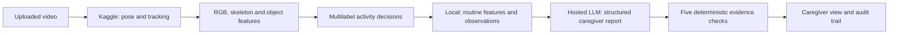

# BehaviorSense AI

**Evidence-backed activity monitoring and caregiver reports for elderly care.**

[PromptWars x Catalyst](https://hack2skill.com/event/promptwars-x-catalyst) · **Chosen vertical: Elderly Care & Assisted Living** · [Run the demo](#run-the-project) · [Backend notebook](notebooks/notebookef04f4f9bb%20%281%29.ipynb) · [Research results](results/rgb_improvement_20261015.md)

BehaviorSense turns uploaded video into activity timelines, observed routine features, and caregiver reports whose structured claims can be checked against the underlying evidence. It helps caregivers review what was observed, including eating, drinking, housework, and medication-related activity, while exposing uncertainty and unsupported claims.

The project is an existing research prototype adapted for this competition. This repository contains a fresh source snapshot for the competition, with one `main` branch. Earlier development history remains available in the [original repository](https://github.com/PARTHG0106/BehaviorSense), and the research reports are included here.

This public submission repository contains about **5.53 MB of source files**. It includes the full application code, tests and Kaggle notebook. See the [submission package details](docs/14_competition_submission.md). Model weights are supplied by the public Kaggle datasets listed below.

## Competition fit and current scope

The published challenge is **Elderly Care & Medication Management Platform**. It asks for collaborative healthcare profiles, medication schedules and adherence, appointments, passcode-based access, and proactive email reminders. BehaviorSense contributes an observation and reporting layer to that broader platform.

| Challenge requirement | Current implementation |
|---|---|
| Keep family members and caregivers informed | Activity timelines, caregiver reports, evidence references, and visible verification results |
| Make care accessible and reliable | English, Hindi and Marathi caregiver views; partial-observation handling; unsupported claims withheld |
| Monitor medication adherence | Medication-related activity can be observed; ingestion, dosage and adherence to a prescribed schedule are not established |
| Shared healthcare profile and passcode access | Planned. Optional resident enrollment and a backend token exist, but there is no shared healthcare-profile access system |
| Add/edit medication schedules and doctor appointments | Planned |
| Email reminders for upcoming or missed doses and appointments | Planned |

The current submission demonstrates activity monitoring and verified reporting. Scheduling, appointment management, collaborative profile access, and email reminders remain the next product features.

## What you can demonstrate

- Upload a video and inspect tracked people, activity segments, and the outputs of each processing stage.
- Detect multiple activities in the same window, including the saved TV-plus-drinking decision rule.
- Review observed durations and event counts without treating a short clip as a full day of history.
- Generate a caregiver report through a hosted language model and inspect the evidence for each structured claim.
- View caregiver reports in English, Hindi or Marathi, with the original report and evidence audit available.
- Optionally enroll a resident for appearance-based role matching.
- Process two clips concurrently, using one Kaggle T4 GPU per clip.

## How it works



**Kaggle runs stages 1–2:** RTMO pose extraction, tracking, optional OSNet role matching, RT-DETR object context, Swin3D-T visual features, and the saved RGB hybrid's activity decisions.

**Your machine runs stages 3–4:** routine-feature processing, the OpenRouter report request, report translation, and evidence verification. The browser is a static HTML/CSS/JavaScript app. Language-model API keys stay on your machine; the reporting model receives structured observations rather than video.

The RGB hybrid combines **37.5% context seed 2, 37.5% temporal ASL seed 1, and 25% RGB**. Class thresholds and the TV-plus-drinking rule are frozen. The current Kaggle runtime uses FP32 on T4 and supports offline video processing.

## Run the project

### 1. Clone and install the local dependencies

Use Python **3.11 or later**. From PowerShell:

```powershell
git clone https://github.com/PARTHG0106/BehaviorSense-PromptWars.git
cd BehaviorSense-PromptWars
python -m venv .venv
.\.venv\Scripts\Activate.ps1
python -m pip install --upgrade pip
python -m pip install -r requirements-serve.txt
```

On Linux/macOS, activate with `source .venv/bin/activate`. A local GPU or local activity-model weights are unnecessary for this split setup.

### 2. Run the supplied notebook on Kaggle

Download/import **[notebookef04f4f9bb (1).ipynb](notebooks/notebookef04f4f9bb%20%281%29.ipynb)** into Kaggle. This is the backend notebook for the competition demo.

Select **GPU T4 x2** and **Internet On**, then add these two public datasets:

| Public dataset | What it supplies |
|---|---|
| [penguin069/behaviorsense-rgb-hybrid-serving](https://www.kaggle.com/datasets/penguin069/behaviorsense-rgb-hybrid-serving) | GPU runtime source, three trained heads, frozen thresholds and normalization, Swin3D-T and OSNet |
| [krishnagupta02468/behavioursense-ww](https://www.kaggle.com/datasets/krishnagupta02468/behavioursense-ww) | `weights/rtmo-l.onnx` and `rtdetr-l.onnx` |

Run the notebook cells in order. They verify the bundled files, install the GPU dependencies, and test the required model forwards on **both** T4 GPUs before starting the API.

For live demo access control, set `BS_TOKEN` to a private value before running the notebook's service-configuration cell, then pass the same value to the local bridge with `--token`. This is a shared backend token; per-person healthcare-profile permissions remain pending.

Keep the final cell running. It prints a command containing a link such as:

```text
python web/local_backend.py --kaggle https://YOUR-SESSION.trycloudflare.com
```

Use the link from your current session. It changes when the notebook restarts and stops working when the session ends. The notebook reads its GPU code from the serving dataset; the cloned repository provides your local bridge and web app.

No Qwen model dataset, original Toyota training runs, raw Toyota videos, pose shards, or separate code dataset is needed to run this demo.

### 3. Start the local reporting bridge

In a local terminal with the virtual environment active, set your OpenRouter key and run the command printed by Kaggle:

```powershell
$env:OPENROUTER_API_KEY_1 = "YOUR_OPENROUTER_API_KEY"
python web/local_backend.py --kaggle https://YOUR-SESSION.trycloudflare.com
```

For Linux/macOS, use `export OPENROUTER_API_KEY_1="YOUR_OPENROUTER_API_KEY"`. Multiple keys can be configured through `OPENROUTER_API_KEY_LIST`. The bridge supports `--model` for selecting a compatible OpenRouter model and reports the actual provider used.

The bridge listens at **http://127.0.0.1:8899**. If you set `BS_TOKEN` in the notebook, pass the same value to this command with `--token`.

### 4. Open the web app

In a second terminal from the repository root:

```powershell
python -m http.server 5173 --bind 127.0.0.1 --directory web
```

Open **http://127.0.0.1:5173** and connect the page's backend field to **http://127.0.0.1:8899**. Upload a clip, inspect the processing stages, and choose the caregiver report language.

The Cloudflare address belongs in the `--kaggle` command. The web page connects to your **local bridge**.

### Offline interface preview

To review the interface and evidence checks with stored/synthetic fixtures:

```powershell
python web/dev_backend.py
```

Serve `web/` as above and connect to `http://127.0.0.1:8899`. This preview uses fixtures; real uploaded-video inference requires the Kaggle backend.

## Prompting and verifiable reporting

The report prompt is built from the actual observations and a filled evidence template. It asks the model to copy evidence references and numeric values, omit unsupported comparisons, respect the observation window, and return a bounded JSON report.

The implementation is in [`reporter.py`](src/behaviorsense/agents/reasoning/reporter.py). The resulting structured claims pass through [`verifier.py`](src/behaviorsense/agents/reasoning/verifier.py):

| Check | What it verifies |
|---|---|
| C1 | The cited evidence exists |
| C2 | The claimed numeric value matches the evidence |
| C3 | A claimed percentage change matches a supported comparison |
| C4 | The direction and wording agree with the evidence |
| C5 | The claim's prose contains the supported numeric value |

The caregiver view withholds structured claims that fail these checks. The browser also implements the evidence checks so users can inspect their results. These checks establish consistency with recorded observations; they do not verify the visual model's predictions or the report's free-text recommendation.

## Evidence and validation

| Evidence | Result and scope |
|---|---|
| Historical RGB hybrid benchmark | mAP **65.29% → 69.21%** and TV-plus-drinking F1 **19.07% → 28.12%** across 153,537 windows and seven test subjects. Pair precision/F1 requirements still failed. [Report](results/rgb_improvement_20261015.md) |
| Fitting-coverage study | mAP **41.44% → 58.25%**, pair F1 **4.53% → 13.88%**. Exploratory subject-separated coverage comparison; its advancement gate failed. [Report](results/rgb_fitting_coverage_20261016.md) |
| Supplied Kaggle notebook | Successful model-forward smoke checks on **two Tesla T4 GPUs using FP32**, plus backend startup. [Recorded evidence](results/kaggle_backend_smoke_20261115.md) |
| Local submission validation | 49 suites covered; **910/910 reported tests passed**, with 5 skipped, across the full run and corrective reruns. [Validation record](results/submission_validation_20261115.md) |
| Behaviour-layer simulation | 24/24 targeted anomaly cases detected; median latency 4 days; 5.07 false alerts per 100 control resident-days. Synthetic scenarios, not clinical validation. [Report](results/behaviour_eval.md) |

The original RGB accuracy benchmark used a different GPU and BF16 feature extraction. The T4 smoke checks confirm startup and model execution; they do not establish the accuracy of this FP32 tracked-person adapter. Earlier validation/test inspection also limits independent generalization claims.

Run the isolated CPU suites from the repository root:

```powershell
python -m pip install -r requirements-test.txt
python run_tests.py --all
```

JavaScript checks require **Node.js 22 or later**. The runner tests a temporary source copy and excludes local datasets, model checkpoints, credentials and resident galleries. Use `python run_tests.py --list` or repeat `--suite` to select checks. GPU model smoke checks run inside the Kaggle notebook.

## Alignment with the evaluation focus areas

| Criterion | What reviewers can inspect |
|---|---|
| Code Quality | Separate perception, model, behaviour, reporting, verification and service modules; typed schemas; reusable shared logic; source and tests inside this repository |
| Security | Local API-key handling, ignored credentials and resident galleries, optional backend token, model/source integrity checks, isolated video workers, bounded uploads and deterministic claim verification. Shared healthcare-profile access is still pending |
| Efficiency | One isolated worker per T4, two concurrent clips, bounded admission, chunked uploads, reusable feature computations and cleanup when a worker exits |
| Testing | Isolated CPU suites for models, schemas, services, notebook logic and the web contract; synthetic-video and concurrent-upload checks; recorded model-forward smoke checks on both T4 GPUs |
| Accessibility | English/Hindi/Marathi caregiver views, language-aware controls, activity timelines, visible progress and errors, and inspectable evidence. No formal accessibility certification is claimed |
| Problem Statement Alignment | Elderly-care activity observation and caregiver reporting are implemented; shared passcode profiles, medication schedules, confirmed adherence, appointments and email reminders remain pending |

## Assumptions

- The operator provides a video they are authorized to process and uses a trusted local machine and Kaggle account. Public model datasets do not make uploaded personal video public by design.
- Video has at least 20 FPS and fits the configured upload and duration limits. The demo is offline and uses future context; it is not a continuous real-time monitor.
- An observed medication-related movement is an activity-model prediction, not proof of pill ingestion, dosage or adherence to a prescription.
- Without an enrolled resident, subject selection is declared as an assumption. Motion-only tracking and appearance matching can still make identity errors.
- A short observation window or missing baseline history cannot establish that an activity was absent for the day or that a routine declined.
- The supplied public model bundle and its frozen thresholds are used consistently. GPU startup checks and arithmetic report checks do not establish clinical validity or a new T4 accuracy benchmark.

## Limits and next steps

The demo performs offline analysis with future context. Default uploads are capped at **100 MB** and **30 minutes**; source video must be at least **20 FPS**. A short clip supports statements about what was observed, not a complete medication-adherence history or a diagnosis. The frozen model disables seven unscored classes, including fall classes. Motion-only tracking can also swap identities during crossings.

Next product work is shared healthcare profiles with authorized passcode access, editable medication schedules, explicit adherence confirmations, doctor appointments, and email reminders. Those features should be driven by the elderly person's preferences and explicit care plan, with observed activity kept separate from confirmed medication intake.

## Repository guide

| Path | Purpose |
|---|---|
| [`notebooks/notebookef04f4f9bb (1).ipynb`](notebooks/notebookef04f4f9bb%20%281%29.ipynb) | Primary Kaggle backend notebook for the demo |
| [`web/`](web/README.md) | Static interface and local reporting bridge |
| [`src/behaviorsense/`](src/behaviorsense/) | Perception, models, routine processing, reporting, verification and services |
| [`scripts/`](scripts/) | Training, extraction, packaging and development utilities |
| [`tests/`](tests/) | CPU, service, notebook and JavaScript checks |
| [`docs/13_rgb_hybrid_serving.md`](docs/13_rgb_hybrid_serving.md) | Detailed current backend setup and model portability |
| [`results/`](results/) | Research measurements, scope and limitations |

The older numbered training/evaluation notebooks remain research utilities. Use the supplied notebook above for the current web backend.

## License and attribution

Project source is licensed under [MIT](LICENSE). Pretrained models and research datasets retain their own upstream licenses. RTMO, OSNet, RT-DETR, Video Swin and ST-GCN++ are upstream model families used by this project; their implementations and provenance are documented in the source and [research documentation](docs/02_architecture.md).

Maintainer: [PARTHG0106](https://github.com/PARTHG0106). Development used AI-assisted coding and review; the Git history records the project's evolution.
